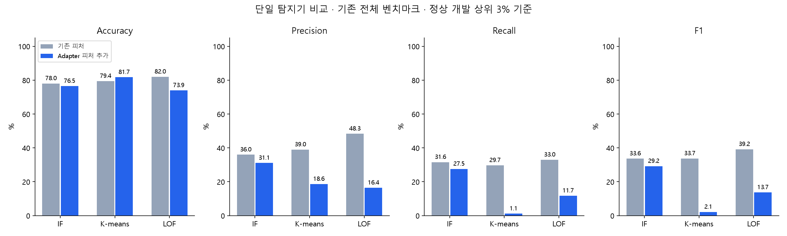
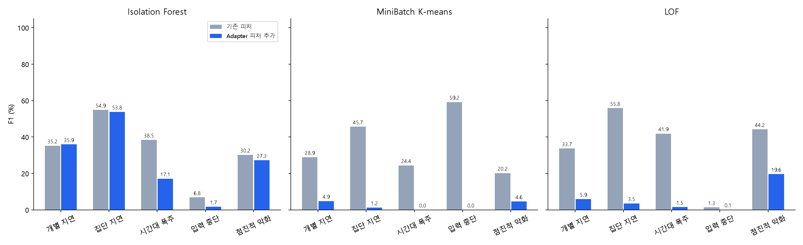

# Adapter 전문가 없이 단일 모델 + Adapter 파생 피처 비교

## 핵심 결과

- Isolation Forest: F1 33.62% → 29.21% (-4.42%p), 정상 오탐률 12.03% → 13.06%
- MiniBatch K-means: F1 33.71% → 2.14% (-31.58%p), 정상 오탐률 9.94% → 1.06%
- LOF: F1 39.19% → 13.68% (-25.51%p), 정상 오탐률 7.53% → 12.76%

| 모델 | Accuracy % | Precision % | Recall % | F1 % | 정상 오탐률 % |
| --- | --- | --- | --- | --- | --- |
| if_baseline | 78.04 | 35.95 | 31.58 | 33.62 | 12.03 |
| if_adapter_features | 76.48 | 31.08 | 27.55 | 29.21 | 13.06 |
| kmeans_baseline | 79.43 | 38.98 | 29.70 | 33.71 | 9.94 |
| kmeans_adapter_features | 81.71 | 18.63 | 1.13 | 2.14 | 1.06 |
| lof_baseline | 81.98 | 48.33 | 32.96 | 39.19 | 7.53 |
| lof_adapter_features | 73.94 | 16.42 | 11.73 | 13.68 | 12.76 |

## 비교 조건

- 각 알고리즘·피처 조합마다 탐지기 정확히 하나. Adapter 전문가, 전문가 fallback, Adapter별 threshold 없음.
- 동일 정상 학습 19,793분, 720개 재생 사례. Adapter 통계도 이 학습 분에서만 생성.
- 독립 정상 개발 17,925분으로 공통 목표 오탐률 3% threshold 설정. 최종 테스트 정답으로 설정 변경 없음.
- 기존 파생 피처 28개 대 기존 + Adapter 피처 10개. 기존 피처에도 이미 Adapter·Process·totalCount 조건부 정보가 있음. 'Adapter 정보 전혀 없음' 대비 실험이 아님.
- IF: 300 trees, max_samples=512. K-means: 16 clusters, batch=2048, n_init=10, 군집별 정상 P95 거리로 정규화. LOF: novelty=True, 35 neighbors, 정상 참조 상한 2,048분, Euclidean. seed=42.
- 입력 스케일은 정상 학습 중앙값·P90-P10, 결측값은 학습 중앙값 대체. 직접 ID·STATUS·시나리오·정답 피처 없음.
- 모든 테스트 2,167,766분을 그대로 평가. 기존 6개 시나리오 + Hard. 5개 주요 시나리오는 아래에 별도 집계.
- 시간창별 판정, point adjustment 없음. Accuracy는 클래스 비율 영향이 있어 F1·Precision·Recall·오탐률·AP·ROC-AUC 함께 확인.
- v18의 전체 경로는 여러 내부 분기를 결합한 모델. 아래 v18 비교는 역사적 참고이며, 동일 구조에서 피처만 바꾼 인과 비교는 위 6개만 해당.

## 추가한 피처

| 컬럼 | 의미 |
| --- | --- |
| `adapter_max_duration_z` | 1분 최대 log 소요시간의 Adapter 과거 중앙값 대비 편차 / IQR |
| `adapter_p95_upper_tail` | 최근 5분 P95가 같은 Adapter의 정상 5분 P95 분포에서 드물게 큰 정도 |
| `adapter_count_p95_z` | Adapter + 최근 5분 평균 totalCount 구간 기준 log P95 편차 / IQR |
| `adapter_count_p95_upper_tail` | 동일 Adapter·처리건수 구간에서 5분 P95가 드물게 큰 정도 |
| `adapter_count_p95_lower_tail` | 동일 Adapter·처리건수 구간에서 5분 P95가 드물게 작은 정도 |
| `adapter_workload_z` | 최근 5분 평균 totalCount의 Adapter 기준 편차 / IQR |
| `adapter_stream_arrivals_z` | 현재 Process 스트림의 1분 실행 횟수를 Adapter·요일유형·시간대 정상 재생 분포와 비교 |
| `adapter_reference_log_duration` | 해당 Adapter·처리건수 구간의 정상 5분 log P95 중앙값 |
| `adapter_delay_short_long` | 처리건수 보정 지연의 최근 5분 평균 - 15분 평균 |
| `adapter_delay_ewma` | 처리건수 보정 지연의 양수 부분 EWMA(alpha=0.2) |

각 Adapter 통계는 **개별 Process 스트림의 분 집계 분포**다. 여러 Process를 합친 Adapter 전체 요청 수가 아니다. 처리건수는 최근 5분 평균 `totalCount`의 log2 구간. 정상 30분 미만이면 Adapter+건수구간 → Adapter → 전체 기준으로 넓힌다. 참고 행 수와 fallback 단계는 진단용이며 탐지기 입력에서 제외한다.

## 주요 5개 시나리오

| 모델 | Accuracy % | Precision % | Recall % | F1 % | 정상 오탐률 % |
| --- | --- | --- | --- | --- | --- |
| if_baseline | 79.06 | 37.24 | 31.60 | 34.19 | 11.07 |
| if_adapter_features | 77.47 | 32.03 | 27.53 | 29.61 | 12.14 |
| kmeans_baseline | 79.65 | 39.11 | 32.76 | 35.65 | 10.60 |
| kmeans_adapter_features | 82.03 | 18.63 | 1.30 | 2.44 | 1.18 |
| lof_baseline | 82.28 | 47.97 | 34.98 | 40.45 | 7.89 |
| lof_adapter_features | 75.41 | 14.84 | 9.05 | 11.24 | 10.80 |

## 기존 v18 모델 참고

| 모델 | Accuracy % | Precision % | Recall % | F1 % | 정상 오탐률 % |
| --- | --- | --- | --- | --- | --- |
| if_global | 86.13 | 74.05 | 32.73 | 45.39 | 2.45 |
| if_ensemble | 86.28 | 72.45 | 35.65 | 47.78 | 2.90 |
| kmeans_global | 85.17 | 65.52 | 33.35 | 44.20 | 3.75 |
| kmeans_ensemble | 84.97 | 63.16 | 35.18 | 45.19 | 4.39 |
| lof_global | 84.58 | 61.39 | 33.61 | 43.44 | 4.52 |
| lof_ensemble | 84.25 | 58.96 | 34.92 | 43.86 | 5.20 |

새 모델이 v18을 대체할 만큼 좋은지와 Adapter 피처 자체가 유용한지는 다른 질문이다. 성능이 낮아도 테스트 결과로 재학습·threshold 변경하지 않는다.

## 해석과 제약

- 정상 데이터만의 추가 진단: `adapter_workload_z`의 정규화 절댓값 P95는 학습 15.13, 정상 개발 921.05. 학습 스케일이 0.05 하한에 걸렸고, 정상 개발 34.62%에서 정규화 절댓값 20 초과. 처리건수는 정상 문맥일 수도 있는데 수치 이탈로 크게 표현된 것. 거리 기반 모델의 높은 정상 개발 점수/threshold와 함께 관측되었으나 해당 피처 하나의 인과적 기여도를 분리한 실험은 아님.
- 다음 검증 후보는 처리건수 자체의 희귀도를 제외하고, totalCount를 소요시간 비교 조건으로만 쓰는 구조 및 정상 개발에서 거의 상수인 피처의 안정적 스케일링. 이번 최종 테스트를 본 뒤 이를 적용해 재선택하지 않았음. 따라서 'Adapter 파생 피처가 원래 무효'라고 일반화할 수 없음.
- 같은 정상 개발 오탐 목표라도 실제 테스트 오탐률은 다를 수 있음. 테스트에서 오탐률을 강제로 맞추거나 최적 F1 threshold를 고르지 않음.
- 학습·개발은 과거 성공(S) 정상 후보를 재생한 데이터. S가 성능 정상임을 보장하지 않으며, 운영 트래픽 빈도를 그대로 대표하지 않음.
- 현재 벤치마크는 사례마다 Adapter+Process 하나만 재생. Adapter 전체 동시 지연 비율·활동 Process 감소율은 계산/검증하지 않음. 서로 독립적인 사례를 같은 시간으로 합쳐 꾸며내지 않음.
- 시간대 실행량 기준은 합성 prior 및 정상 재생 분포에 의존. 운영 Adapter별 실제 과거 집계를 대체하지 않음.
- 알려지지 않은 Adapter는 통합 통계 사용. 낯선 이름 자체를 이상으로 취급하지 않음. 기존 기간 변화와 같은 완전한 Adapter cold-start 전용 성능 검증은 아님.
- 이미 살펴본 합성 벤치마크에서 수행한 연구 비교. 외부 블라인드 운영 성능 보장 아님.
- 점수와 threshold가 실제 경보 근거. 표본의 피처 값은 해석 단서이며 장애 원인이나 정확한 기여도를 증명하지 않음.

## ADBench 활용 검토

별도 [ADBENCH.md](../../code/adapter_feature_ablation/ADBENCH.md) 참고. ADBench를 설치·실행하거나 벤치마크를 변경하지 않았음.

## 재현

`python code/adapter_feature_ablation/run.py --stage train` → `--stage evaluate` → `--stage report`. 동결 파일이 있으면 train 재실행 거부. Python 경로에 code를 넣어 테스트 실행.
