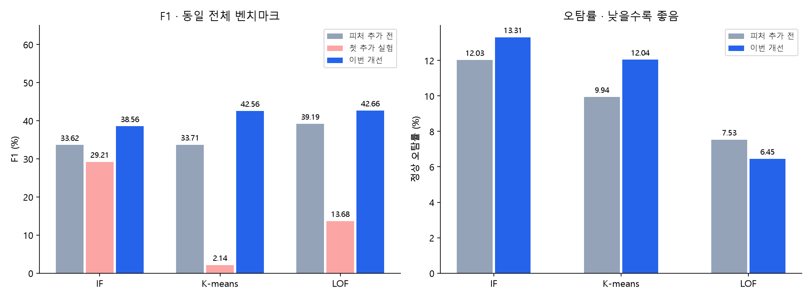
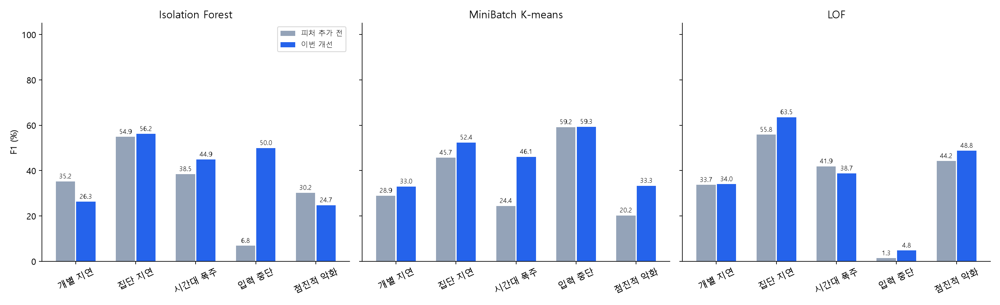

# Adapter 피처를 유지한 단일 모델 개선 결과

## 핵심 결과

- Isolation Forest: F1 33.62% → 38.56% (+4.93%p), Adapter 피처 9개, 목표 달성
- MiniBatch K-means: F1 33.71% → 42.56% (+8.85%p), Adapter 피처 9개, 목표 달성
- LOF: F1 39.19% → 42.66% (+3.47%p), Adapter 피처 9개, 목표 달성

| 모델 | accuracy | precision | recall | f1 | normal_false_positive_rate | average_precision | roc_auc |
| --- | --- | --- | --- | --- | --- | --- | --- |
| if_baseline | 78.04 | 35.95 | 31.58 | 33.62 | 12.03 | 34.45 | 69.2 |
| if_adapter_features | 76.48 | 31.08 | 27.55 | 29.21 | 13.06 | 30.02 | 62.99 |
| kmeans_baseline | 79.43 | 38.98 | 29.7 | 33.71 | 9.94 | 32.77 | 65.89 |
| kmeans_adapter_features | 81.71 | 18.63 | 1.13 | 2.14 | 1.06 | 18.82 | 53.41 |
| lof_baseline | 81.98 | 48.33 | 32.96 | 39.19 | 7.53 | 45.87 | 73.45 |
| lof_adapter_features | 73.94 | 16.42 | 11.73 | 13.68 | 12.76 | 19.09 | 56.56 |
| if_improved | 78.24 | 38.37 | 38.75 | 38.56 | 13.31 | 38.26 | 72.42 |
| kmeans_improved | 79.91 | 42.87 | 42.26 | 42.56 | 12.04 | 37.84 | 71.77 |
| lof_improved | 83.29 | 53.91 | 35.3 | 42.66 | 6.45 | 46.43 | 73.0 |

## 무엇을 바꿨나

- Adapter 피처 10개 중 처리건수 자체의 특이도를 나타내는 `adapter_workload_z` 하나만 제외한 후보 또는 10개 유지 후보 비교. 실제 채택은 아래 설정 참조.
- 단순 강한 선형 스케일링 대신 안정적인 스케일 하한, clip/asinh, QuantileTransformer, Adapter 피처 블록의 양수 가중치를 개발 데이터에서 비교.
- IF는 트리 표본 수/피처 선택 비율, K-means는 군집 수, LOF는 이웃 수/참고 표본 수/중복 제거 비교.
- IF는 중복 기본 피처를 줄이는 full/balanced/compact 후보도 비교. Adapter 피처 9개는 그대로 유지하고 실제 선택한 view와 전체 입력 개수는 노트북 설정 표에 표시.
- LOF hybrid는 기본 28개 피처의 기존 스케일을 그대로 보존하고 Adapter 블록만 안정화.
- 각 알고리즘에 탐지기 하나, Adapter 전문가 없음. 세 알고리즘을 합친 앙상블도 없음.
- 하이퍼파라미터와 threshold도 바뀌었으므로 개선 전체는 순수한 피처 추가만의 효과가 아님.

## 선택과 검증

- 정상 train 19,793분에서만 탐지기·스케일러 학습, 정상 개발 17,925분의 점수 quantile로 경보선 후보 생성.
- search에서 기존 모델 대비 오탐률 +0.5%p 이내(최소 상한 3%), Precision -2%p 이내 제약 후 F1 선택.
- 파라미터 선택에 직접 쓰지 않은 기존 confirmation에서 설정 동결 후 확인. 반복 개선 중 기존 결과를 이미 확인한 연구이며 새로운 외부 블라인드 집단은 아님.
- 알고리즘 학습은 정상 후보만의 비지도, 하이퍼파라미터/경보선 선택은 개발 라벨 활용.
- 이전 실패 실험의 최종 결과를 이미 보고 구조를 개선한 연구. 외부 블라인드 성능으로 주장하지 않음.
- 모든 기존 2,167,766분 평가, 데이터/정답/기존 모델 변경 없음. point adjustment 없음.
- 주요 5개와 전체 6개+Hard를 구분. 점수는 확률이 아니며 score > 고정 threshold에서 경보.

## 주요 5개 합산

| 모델 | accuracy | precision | recall | f1 | normal_false_positive_rate |
| --- | --- | --- | --- | --- | --- |
| if | 79.11 | 39.79 | 41.68 | 40.71 | 13.11 |
| kmeans | 81.78 | 46.85 | 43.57 | 45.15 | 10.28 |
| lof | 83.73 | 53.95 | 37.45 | 44.21 | 6.65 |

## 설정과 성능을 읽을 때

- 세 모델의 강점은 이번 피처와 합성 평가에서 관측된 결과이지 알고리즘의 고유 시나리오 보장은 아님.
- 전수 F1이 올라도 모든 시나리오/Precision/Recall이 동시에 오르는 것은 아님. 전체/시나리오별 실제 표에서 확인.
- QuantileTransformer의 학습 범위 밖 포화와 상관 왜곡 한계: [공식 문서](https://scikit-learn.org/stable/modules/generated/sklearn.preprocessing.QuantileTransformer.html).
- 쌍체 부트스트랩 300회는 같은 사례의 정상/이상 쌍을 함께 재표집. 원본 템플릿/생성기를 공유하므로 운영 일반화의 신뢰구간이 아님.
- 상태 S는 정상 후보이지 성능 정상 보장이 아님. 시간대 prior는 합성. 실시간 운영에는 과거 상태와 빈 시간창 생성/지연 로그 처리 필요.
- 이번 모델을 자동으로 운영 배포하거나 기존 v18을 교체하지 않음.

설정은 selection.json, 경보선과 모델은 handoff/manifest.json, 재계산 검증은 audit.json, 실행된 표/분포는 result.ipynb.
