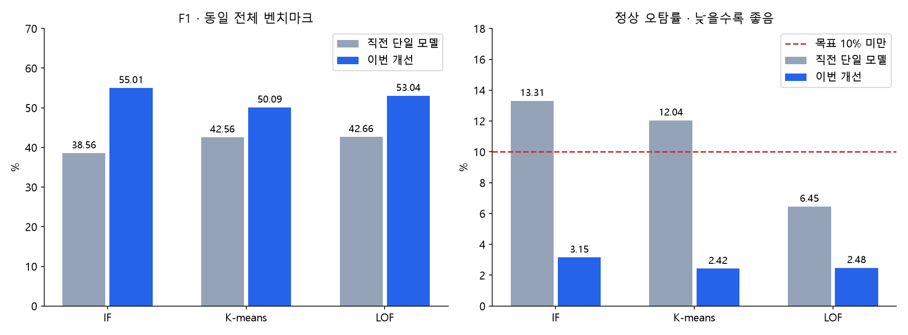
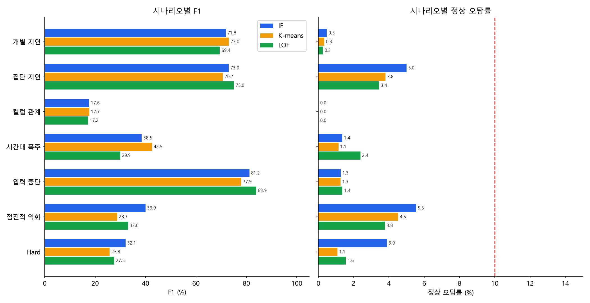

# 단일 모델 + Adapter 피처 · 최종 결과

- IF: F1 38.56% → 55.01%, 정상 오탐률 13.31% → 3.15%
- K-means: F1 42.56% → 50.09%, 정상 오탐률 12.04% → 2.42%
- LOF: F1 42.66% → 53.04%, 정상 오탐률 6.45% → 2.48%

| 모델 | Accuracy | Precision | Recall | F1 | 정상 오탐률 |
| --- | --- | --- | --- | --- | --- |
| IF | 87.46 | 74.7 | 43.53 | 55.01 | 3.15 |
| K-means | 86.94 | 76.64 | 37.2 | 50.09 | 2.42 |
| LOF | 87.44 | 77.66 | 40.27 | 53.04 | 2.48 |

전체 기존 벤치마크 2,167,766분. Adapter 전문가 없음, 모델별 26개 피처 중 Adapter 통계 9개. 기존 데이터/정답 변경 없음.

설정 선택은 개발 라벨을 사용했으며 기존 평가 결과가 구조 설계에 영향을 준 반복 연구다. 외부 블라인드 평가가 아니다. 새 seed 확인 사례에서도 별도 평가했으며 재선택에 사용하지 않았다.

기존 5~15분 지연의 복구 후 잔존 영향을 줄이고 현재 완료 1분 근거를 중심으로 재구성했다. IF는 정상 공분산 안정화/공통 회전, K-means는 16개 군집과 반경 정규화, LOF는 이웃 500/정상 참조 4096으로 선택했다. 순수 Adapter 피처 추가 효과만의 비교는 아니다.

전체 해석·분포·정확한 파라미터·ADBench 검토: `code/shared_model_target/result.ipynb`. 저장 모델: `handoff/`. 독립 재계산 검증: `audit.json`.
