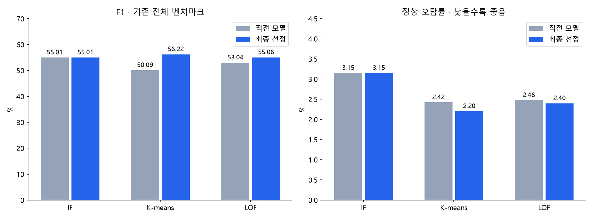
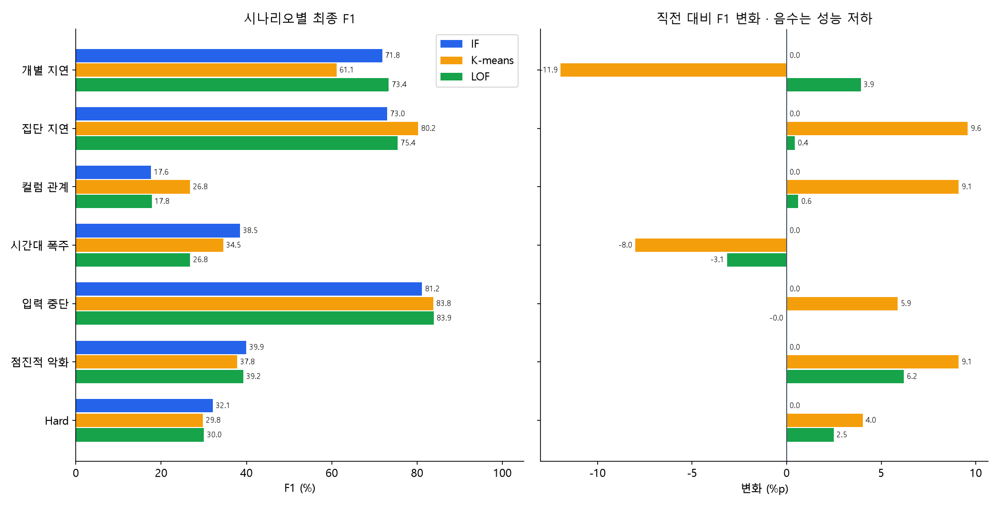
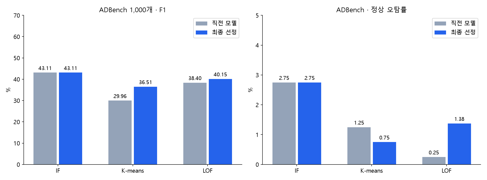

# 단일 모델 개선 결과

- IF: F1 55.01% → 55.01%; 정상 오탐률 3.15% → 3.15%
- K-means: F1 50.09% → 56.22%; 정상 오탐률 2.42% → 2.20%
- LOF: F1 53.04% → 55.06%; 정상 오탐률 2.48% → 2.40%

기존 전체 2,167,766분 평가, 6개+Hard 포함. 데이터·정답 변경 없음. IF는 기존 모델 유지.

상세 설정·분포·회귀 시나리오·실험 한계는 code/shared_model_v2/result.ipynb 참조.
기존 벤치마크 결과를 보고 개선한 반복 연구이며 외부 블라인드 테스트가 아니다. ADBench는 별도 피처 공간 평가이다.
