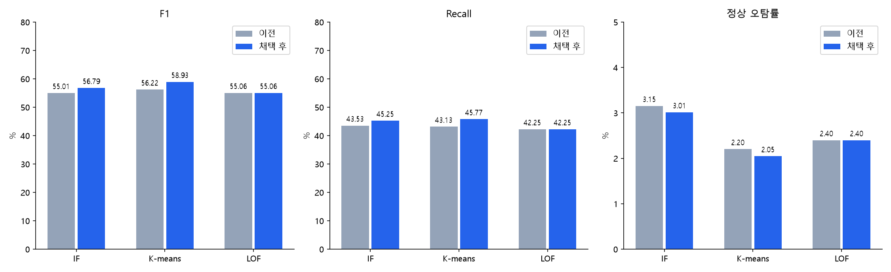

# F1·Recall 개선 실험

- if: F1 56.79%, Recall 45.25%, 정상 오탐률 3.01%
- kmeans: F1 58.93%, Recall 45.77%, 정상 오탐률 2.05%
- lof: F1 55.06%, Recall 42.25%, 정상 오탐률 2.40%

- if: F1 +1.79%p / Recall +1.72%p / 오탐률 -0.14%p / +10%p 목표 False
- kmeans: F1 +2.71%p / Recall +2.64%p / 오탐률 -0.16%p / +10%p 목표 False
- lof: F1 +0.00%p / Recall +0.00%p / 오탐률 +0.00%p / +10%p 목표 False

기존 데이터·정답 변경 없음. 오탐률 증가 또는 F1/Recall 회귀 후보는 미채택. 개발 설정 선택 및 연구 벤치마크 채택 편향 있음. 외부 블라인드 결과가 아님.

## 새 seed 확인

IF는 개선이 재현됐지만 K-means는 F1 60.86→60.29%, Recall 49.08→47.37%로 하락. 오탐은 감소. K-means 일반화 개선은 미확인. 모델 재선택에는 사용하지 않았으며 운영 배포 승인이 아닌 연구 후보 묶음.
