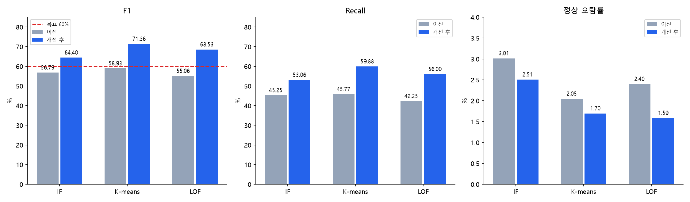

# F1 60% 이상 / 기존 정상 오탐 상한 유지

## 기존 Process 로그: 달성

동일 2,167,766개 1분 판정. 데이터·정답·Hard·난이도 유지, point adjustment 없음.

| 모델 | 이전 F1 → 최종 | 이전 오탐률 → 최종 | 최종 FP / 허용 상한 |
|---|---:|---:|---:|
| IF | 56.79% → 64.40% | 3.01% → 2.51% | 44,773 / 53,829 |
| K-means | 58.93% → 71.36% | 2.05% → 1.70% | 30,282 / 36,546 |
| LOF | 55.06% → 68.53% | 2.40% → 1.59% | 28,312 / 42,848 |

시나리오별 목표를 모두 달성한 것은 아니다. IF 개별 지연·컬럼 관계의 TP=0, LOF 시간대 폭주 저하 등 회귀가 남았다. 전체 F1만으로 운영 후보를 확정하지 말 것.

## ADBench 별도 정상 재학습: 달성

기존 ADBench 공식 생성기 기반 1,000개, 정상 800 / 이상 200. ADBench 전체 실제 데이터셋의 종합 결과가 아니다.

| 모델 | F1 | 정상 오탐률 | FP / 기존 상한 |
|---|---:|---:|---:|
| IF | 69.49% | 2.00% | 16 / 22 |
| K-means | 66.67% | 0.75% | 6 / 6 |
| LOF | 64.31% | 1.375% | 11 / 11 |

**ADBench 숫자는 서비스 모델과 다른, 별도 재학습 모델의 결과이다.** 서비스 모델 그대로의 전이는 IF 8.22% / K-means 33.33% / LOF 0% F1로 미달. K-means는 정상 800개 전부 경보했으므로 이 피처 표를 서비스 입력처럼 취급하지 말 것.

## 검증 및 한계

- 최종 정책 동결 후 새 seed 48600042의 47,608개 분 판정: IF 68.20% / K-means 72.60% / LOF 71.05% F1, 이전 모델보다 오탐 수 감소
- 같은 원본 pool 및 원형 생성기이므로 외부 블라인드 평가 아님; 새 seed 결과로 재선택하지 않음
- 전체 고정 벤치마크 파일 해시 확인, 62개 단위 테스트, 원시 Process 입력·저장/로드·미지 Adapter·과거 판정 인과성 검증
- ADBench train/cal/dev/test의 정확히 동일한 피처 벡터 중복 0건, 기존 1,000개 변경 없음
- 기존 전체 평가 결과를 보고 정책을 재설계한 반복 연구; 테스트 ROC에서 cutoff를 역산하지 않았어도 블라인드 성능이라고 주장할 수 없음

실행된 노트북: `code/shared_model_v4/result.ipynb`.
코드·입력·모델 파일 설명: `code/shared_model_v4/README.md`.
운영 연결 후보: 이 폴더의 `handoff/`.
ADBench 전용 모델: `reports/shared_model_v4_adbench_release/`.
GitHub·Notion·운영 배포 변경 없음.
