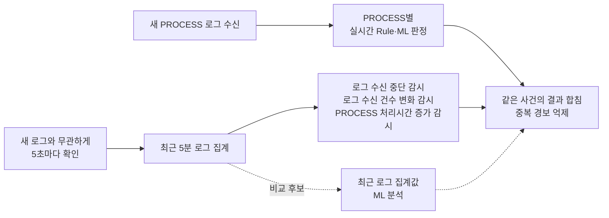

# 실시간·시간창 병행 공정 비교 v4

- 상태: 품질·전체 부하 집계·최종 독립 검수 완료. 이번 수정은 설명 용어 정리이며 실험 결과·설정 변경 없음
- 목적: 독립 시간창 감시의 추가 효과와 추세 ML의 추가 가치·비용 구분
- 대상: `A` 실시간 / `B` A+시간창 Rule / `C` A+시간창 ML / `D` A+Rule+ML
- 운영 코드·DB·서버 적용 없음

## 표현·판정 기준

| 표현 | 의미 |
|---|---|
| 로그 수신 중단 감시 | 업무 운영 중 평소 간격을 넘어 새 로그가 들어오지 않는지 확인. 서비스 장애·원천 API 지연·수집 실패를 같은 원인으로 단정하지 않음 |
| 로그 수신 건수 변화 감시 | 최근 일정 시간의 수신 건수를 정상 기준과 비교. 로그 수신 건수와 로그 안의 `totalCount` 값은 별개 |
| PROCESS 처리시간 증가 감시 | 완료된 PROCESS의 처리시간을 정상 기준과 비교. 완료 로그가 없는 PROCESS의 정체 여부는 별도 근거 필요 |
| 시간창·확인 주기 | 시간창은 한 번 분석하는 로그 구간(최근5분), 확인 주기는 다시 분석하는 간격(5초/60초) |
| 시간창 ML·추세 ML | 개별 PROCESS 대신 최근 일정 시간의 집계값을 분석하는 모델. 향후 장애 예측을 뜻하지 않음 |
| 경보 허용 기준(경보 예산) | 정상 감시시간당 최종 경보 수의 실험 허용 기준. 서비스 장애의 심각도 기준과 별개 |
| 실행 슬롯 | 경로별 동시에 처리할 작업 수. CPU·컨테이너 개수와 별개 |
| P95/P99 지연 | 완료 작업의95%/99%가 해당 시간 이내 처리. 버려지거나 미완료된 작업은 전체 예정 실패율에 별도 포함 |
| TP/FP | TP는 실제 이상을 탐지한 경우, FP는 정상인데 경보한 경우. 실제 정상/이상 정답이 없으면 둘 중 하나로 분류하지 않음 |

## 자료·실험 조건

- 최신 연구: [PR47](https://github.com/kohs2k21/2026-2-CECD2-1-POWERCODE-03/pull/47), 고정 `cb006179ec61531e547af3d33269cd596084fb5f`
- 원본 v12: 완료 로그의 1분 grid·분기 expert 구조. 업로드 IF/KMeans smoke·회귀 6개 통과; 누락 과거 분기/원천 정답으로 원본 전체 재학습·성능 재현 불가
- 이번 모델: 기존 PROCESS 입력 + 최신 소스의 estimator/score 재사용·새 균형 합성 자료 재fit. 원본 v12의 입력·expert routing·성능과 동일하지 않음
- 신규 seed 451~455·시간순 train/calibration/threshold/validation/test·각 역할 14일 요일/시간 균형·달력 피처 활성
- 최종 정상 감시 112시간(22.4시간/seed), 주요 시나리오 630사건·논리 count 계약 위반 105사건 별도
- 300초 창·60초/5초 주기·Rule/ML 공통 관측시계/가시성·정상 기준·최종 합집합 경보 예산 0.1/0.5/1회/h
- 임계값/후보 선택은 validation까지; 최종 test의 실패를 그대로 보고·재선정 없음
- 공통 PROCESS IF: 32 trees·max_samples256·정상 threshold 점수 최댓값의 다음 float 고정. 시간창 IF128 trees·max_samples512/KMeans6 clusters

## 품질 결과

| 비교군 | 주요 사건 탐지 | 해석 |
|---|---:|---|
| A | 11/630 | 이번 보수적 PROCESS ML·논리 count Rule 기준선 |
| B | 630/630 | 로그 수신 중단 감시·로그 수신 건수 변화 감시·PROCESS 처리시간 증가 감시 Rule 추가 |
| C · IF | 60초 62/630, 5초 141/630 | 0.1회/h 후보의 최종 시험 결과; 일부 seed 예산 초과 |
| C · KMeans | 630/630 | 모든 예산 동일 탐지, 일부 seed 예산 초과·대조 경보 |
| D | 630/630 | B 대비 추가/소실 사건 모두 0개, 모든 예산·seed 동일 |

- B 최종 정상 경보: 3/112h = 0.0268회/h. seed별 `[2,0,0,1,0]`건/22.4h·0.1 예산 모두 충족
- IF C: 60초 `[62,96,96]`/630, 5초 `[141,141,186]`/630(예산 0.1/0.5/1 순)
- IF C/D: 0.1·5초에서 seed451/454 예산 초과, 1.0·5초에서 seed455 24/22.4h = 1.0714회/h 초과. 합계 평균으로 실패 은폐 금지
- KMeans C/D: 0.1·60초 seed452, 0.1·5초 seed451 예산 초과. 동일 사건에서 B 대비 평균 최초 탐지 약 8~11초 단축; 해당 후보의 예산 실패와 함께 판단

### 로그 수신 중단 감시 결과

| 구성 | 탐지 | 평균 최초 탐지 지연 |
|---|---:|---:|
| A | 0/105 | 새 로그가 수신되지 않아 신규 PROCESS 판정 기회 없음 |
| B · 60초 | 105/105 | 60초 |
| B · 5초 | 105/105 | 21.619초 |
| KMeans C · 60초/5초 | 105/105 | 60초/21초 |
| IF C · 60초/5초 | 41/105, 90/105 | 동일 입력·예산에서 일부 미탐지 |

- 새 로그 도착과 무관하게 주기적으로 확인하는 타이머의 가치 확인. 로그 수신 중단 감시에 ML이 반드시 필요하다는 근거 없음
- 주기5초와 탐지 지연2~3초는 동일하지 않음; 새 로그 수신 간격 기준과 외부 공개 지연 별도

### 관측·대조·복구

- 탐지 전제조건 확인(guard): 업무 비운영 시간·수집 상태 확인 불가·원천 API의 로그 공개 상태 확인 불가·정상 저빈도 대조 경보0
- 미완료 대조 35구간: KMeans C/D 60초35경보·5초36~38경보. 정상112h 경보율 분모와 별도; 원본 v12 expert gating의 결과로 해석 금지
- 해당 대조는 주입 후 완료가 관측 종료까지 발생하지 않는 합성 조건. `clean`은 control 메타데이터이며 서비스 정상 정답이 아님. 정상 진행·정체·완료정보 미관측의 정답 미확정으로 경보를 TP/FP로 단정하지 않음; B의 무경보도 정상성 증거와 구분
- 복구 후 남은 이상 이력의 경보·첫 유효 무경보 시점·관측 종료까지 무경보 복구를 확인하지 못한 경우(right-censor) 별도 집계. 정상 오경보/장애 진행 중 탐지 성공(hit)에 합산 금지
- 시나리오 감시시간 metadata 일부 tick 폭 과대 표기. 정상240초 블록·112h 경보 예산 분모 영향 없음
- 0경보 Poisson 예시는 실제3경보가 발생한 A/B의 경보율 상한으로 사용 금지

## 실제 부하 — 전체 16블록·64trial 완료

- IF·seed451·validation에서 봉인한 1.0회/h 후보 고정. 품질표의 대표 0.1회/h 후보와 비용 측정 범위 구분
- 군별 CPU1·RT1/trend1·4군 동시·4회 코어 교환. 공유 Windows 호스트·CPU affinity는 독점 자원 보장 아님
- 입력 빈도는 로컬 합성 PROCESS의 해당 시점 관측값(snapshot)/초. 학습용 고정 데이터셋·고객 API 로그 처리량과 구분; 네트워크·DB·SSE 제외, 예정 시점부터 피처 준비·추론 완료까지 계측
- 준비900초·연산 warmup10Hz/60초600건·실측10/100Hz600초·추세60/5초·drain최대60초
- warmup 전량 완료·네 군 ready/hash 일치 후 공통 시작. drop·미제출·pending 포함 전체 예정 분모, 준비/실측/drain 분리
- 예비100Hz·실측60초·추세5초: 모든 군 큐 포화·약40% drop·실시간 P95 약24초. 정식 반복 결과로 확정 전 일반화 금지
- 예비 외부 메모리 probe: Windows venv launcher stub만 계측한 오류. worker 자체 CPU/RSS·affinity/threadpool 검증은 유효; stub 합계는 폐기·교정 재시험
- 각 조건 600초·4회·A/B/C/D, 총16블록·64trial. 예정 RT2,112,000건: 완료969,842·drop1,142,158·완료 후3초 초과772,311. 전체 예정 기준 실패 또는3초 초과1,914,469건; missing/pending/error0
- 예정 추세3,120건 전량 완료·실패/3초 초과0. 완료된 RT 중drain 완료31,989건 별도 기록
- 중단 이력: 유효 원1~5·재개6 보존, 원6 외부 중단·재개7 실측 전 Windows 파일 교체 오류는 partial로 보존·완료 집계 제외
- IO 보완: peer 검증은 immutable 준비 계약 사용. 입력·추론·측정 코드 동등성과 동시 파일 처리·66시험 독립 검증 후 잔여7~16 완료
- 전체18시도 중 유효16블록·partial2개. 구버전6블록+IO 보완10블록의 출처와 원본255파일·동결9파일·새 준비 계약40파일 불변 확인. 전체시도 무실패 주장과 구분

### 조건별 실시간 결과 — A/B/C/D 각4회

| 입력 빈도·추세 주기 | RT 완료/예정 | drop | 전체 예정 실패 또는3초 초과 | 완료 RT의 trial별 P95 범위 |
|---|---:|---:|---:|---:|
| 10건/초·60초 | 96,000/96,000 | 0 | 0% | 24.19~26.97ms |
| 10건/초·5초 | 96,000/96,000 | 0 | 0% | 25.34~36.77ms |
| 100건/초·60초 | 401,511/960,000 | 558,489 | 99.6896% | 25.17~30.22초 |
| 100건/초·5초 | 376,331/960,000 | 583,669 | 99.7343% | 25.90~32.24초 |

- P95 범위: trial별 완료 건의 분위수 최솟값~최댓값; 모든 원시 행의 pooled 분위수와 구분
- 고입력에서는 A도 포화. 병행 구조만의 실패·추세 ML만의 비용으로 귀속 금지
- 조건 순서 고정·호스트 공유·완료량/drop 차이로 조건 간 속도 우열·운영 처리량 일반화 제한

### 완료된 10건/초 조건 — 각4회

| 추세 주기 | D−A 실시간 P95 평균 차이 | 반복별 차이 범위 | D−A CPU 평균 차이 |
|---|---:|---:|---:|
| 60초 | +0.044ms | −1.319~+0.811ms | −1.129초 |
| 5초 | +0.978ms | −1.161~+2.444ms | +1.102초 |

- 총8블록·32trial, 실시간192,000건/추세1,560건 전량 완료·전체 예정 기준3초 초과/실패0
- CPU 차이는 군별600초 측정과 drain의 누적 차이. 음수 차이를 병렬 가속/CPU 절감 효과로 해석 금지
- 작은 구성 간 차이를 확인한 공유 호스트 비교; 통계적 동등성·서버 SLA·100건/초 처리 능력의 근거와 구분

### 과부하의 동일 반복끼리 비교(paired)·메모리

- 100건/초 D−A P95 차이: 60초 평균−0.450초(−3.250~+2.022), 5초 평균+0.219초(−2.856~+3.081). 반복별 부호 혼재·완료량 차이 때문에 가속/악화 단정 금지
- worker별 peak RSS(측정+drain): 조건별 약182~186MB(10건/초), 261~272MB(100건/초). 네 군의 launcher·실제 interpreter 등 전용 process tree의 동시 RSS 합 peak(측정600초 중5초 표본) 약799~1,135MB; 개별 peak 합산·drain 포함 최대와 구분
- 모든 군에 공통 모델 bundle 적재. RSS 차이는 추세 모델을 추가 적재하는 운영 구성의 순수 메모리 비용이 아님
- 원시 예정/제출/시작/완료·producer/queue/compute·CPU/RSS·실제 affinity·BLAS1 기록. 추세60초/5초 모두 P99 미보고; 특히60초 표본 수 제한

---

## 현재 해석·후속 후보

- 기본 후보: 실시간 PROCESS Rule·ML + 독립 시간창 통계 Rule 감시 병행. 최근5분 창·5초 주기를 초기 후보로 제안; 최적값 확정과 구분
- 검증 대상: 새 입력을 처리하는 경로와 입력이 없어도 실행되는 감시 경로의 보완. 동일 CPU의 병렬 실행에 의한 속도 향상 검증과 구분
- 추세 ML: 주요630사건의 추가 탐지 근거 미확보, 빠른 탐지 이득·예산 실패·정답 미확정 미완료 반응을 함께 검토할 후보
- A의 약한 기준선·PROCESS 통계 Rule 부재·큰 합성 개입으로 전체 A→B 차이의 일반화 제한
- Rule에 맞춘 알려진 합성 현상만으로 실제 고객/새 복합 장애에서 Rule만 충분하다고 결론 금지
- KMeans 부하 비용·원본 v12 전체 재현·고객 데이터 효과·운영 ESB 발생→판정2~3초 미검증
- 모델/최적 주기/컨테이너/운영 채택은 추가 증거와 승인 후 결정

- 위 그림은 실험 후 제안한 초기 구성. 로그 수신 중단만으로 고객 서비스 장애 확정 금지; 업무 일정·수집 상태·원천 API 공개 상태 확인 필요

## 재현·원시 근거

- 품질: `python -m research.evaluation.detector_dual_path.v4 --output research/evaluation/detector_dual_path/runs/v4_balanced_20261014`
- 시험: `python -m unittest discover -s research/evaluation/detector_dual_path/tests`
- 규약: [V4_PROTOCOL.md](V4_PROTOCOL.md), 기존 v3: [RESULTS.md](RESULTS.md)
- ignored 품질 원시/manifest/seal/모델·`audit_quality.json`/`audit_group_metrics.csv`/`audit_scenario_metrics.csv`/`audit_fitted_artifacts.json`
- 독립 검증: 품질61시험 PASS·5seed 692.257초·240선택군·159,600블록 경보/정답 집계·4,200지원행·source/모델/선택 hash 대조. IO 보완 후 기존61+회귀5 = 66시험 PASS
- 부하 원시: `runs/v4_load_20261014/full/` 완료1~5·`resume/` 완료6·`resume2/` 완료7~16, partial2개 별도 보존
- 독립 합산: `runs/v4_load_20261014/io_control_tester/final_raw64/`의 trial/조건/군/paired CSV·JSON·프로세스 종료 감사. 결과 비교표와 재현 범위: [REPRODUCTION.md](REPRODUCTION.md)
- 원시 runs·고객 원본·개인 기록은 Git 업로드 제외
