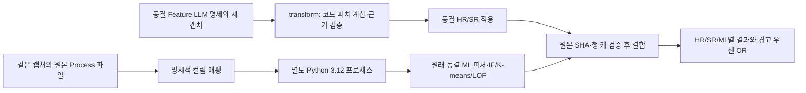

# 최신 PR #98 / Issue #95 연결

이 경로는 `feat/95-model-input-change`의 커밋 `4492722d2d70439e63bfbe48df2fa115180cd94c`에서 가져온
`research/process_event_model/`을 사용한다. 해당 패키지 219개 파일은 원형 그대로 보존한다.
기존 1분 모델과 새 Process 모델의 입력 계약을 구분하며, 기본 알고리즘은 최신 Process 행 IF·K-means·LOF 3개다.
원래 PR #98 자체를 dev에 병합하거나 다른 팀원의 브랜치를 수정하는 작업은 하지 않는다.

## 연결 구조



LLM의 임의 피처를 기존 학습 모델의 입력 열에 추가하거나 이름만 바꿔 넣지 않는다.
LLM 명세 피처와 ML 내부 피처는 같은 원본 Process 행을 사용하지만 서로 다른 계산 계약이다.
모든 LLM 피처를 ML에도 쓰려면 별도 피처 선택·전처리·재학습·검증이 필요하며 이번 작업에서는 실행하지 않았다.
기존 `fit`·`predict`는 과거 공통 피처 연구 프로필로 보존하고, 최신 동결 모델은 `predict-process`로 사용한다.

## 실행 환경

오케스트레이터·Feature/Rule 코드는 기존 프로젝트 Python 3.10 `.venv`를 사용한다.
2026-11-06 사용자가 승인한 최신 ML 전용 환경은 프로젝트 내부 `.venv-process-event`의 Python 3.12다.
원래 `.venv`의 패키지를 업그레이드하지 않는다. ML 프로세스의 PYTHONPATH/PYTHONHOME을 비우고
해당 패키지 `code`만 추가하므로 두 연구 트리의 동명 Python 모듈이 섞이지 않는다.

```bash
# 프로젝트 안에서 최초 1회, 설치 승인을 받은 경우에만 실행
uv venv --python python3.12 '/home/msko20702/#종합설계/data/.venv-process-event'
uv pip install --python '/home/msko20702/#종합설계/data/.venv-process-event/bin/python' \
  --requirement research/process_event_model/requirements.txt
```

ML은 NumPy 2.5.3, pandas 3.0.6, scikit-learn 1.9.1, SciPy 1.18.1, joblib 1.6.0을 요구한다.
실행 전에 Python·패키지 버전, 모델·정책·코드 inventory SHA를 검사한다.
버전이 다르면 강제 로드·자동 설치·자동 fit 대신 평가 불가를 기록한다.

## 최신 ML만 먼저 확인

저장소 루트에서 아래 명령을 실행한다. 예제는 새로 만든 가상 Process 12개이며 고객 정상 정답이 아니다.

```bash
'/home/msko20702/#종합설계/data/.venv/bin/python' -B \
  -m research.integration.feature_rule_ml predict-process \
  --processes research/process_event_model/examples/completed_process.json \
  --runtime-python '/home/msko20702/#종합설계/data/.venv-process-event/bin/python' \
  --output /your/new-process-evaluation --trust-local-model
```

원래 모델의 `anomaly`를 기본으로 사용한다. `--ml-decision confirmed_anomaly`를 주면
원래 incident policy의 확인 판정을 선택한다. 두 판정과 incident 상태를 모두 기록하며,
현재 행의 점 경보와 이미 열린 incident를 같은 뜻으로 합치지 않는다. 점수는 클수록 이상이며 확률이 아니다.

## 우리 Feature·Rule과 같은 원천에서 실행

1. 기존 공식 LLM 명세 생성/검증 결과로 `prepare`를 수행한다. 새 데이터라면 `transform`으로 동일한 동결 피처를 다시 계산한다.
2. 변환에 사용한 **동일한 Process 원천 파일**을 `--processes`로 전달한다.
3. `--rule-group`으로 원본 Process 행 grain 하나를 선택하고, grain 키 순서대로 canonical 키를 명시한다.

```bash
'/home/msko20702/#종합설계/data/.venv/bin/python' -B \
  -m research.integration.feature_rule_ml predict-process \
  --processes /your/approved/EC_PROCESS_MONITORING.csv \
  --field-map research/integration/feature_rule_ml/examples/process_fields.esb.json \
  --prepared /your/transformed-process-feature-pack \
  --rule-group grain_FROM_prepared_json \
  --row-key-fields transactionId processId \
  --runtime-python '/home/msko20702/#종합설계/data/.venv-process-event/bin/python' \
  --output /your/new-combined-evaluation --trust-local-model
```

위 두 키 예시는 grain이 `(TRANSACTION_ID, PROCESS_ID)`일 때만 해당한다.
재시도·중복 실행을 구분하는 키가 있으면 실제 grain에 맞게 모두 명시한다. 키를 임의로 줄이지 않는다.
원천 파일 SHA, 원래 물리 키 매핑, 전체 키의 일대일 일치를 확인하므로 같은 ID의 오래된 피처를 재사용하거나
부분 조인·다른 테이블의 거래 단위 규칙을 자동 배포하지 않는다.
`--prepared`가 없으면 HR/SR은 평가 불가로 남는다. 준비되지 않은 규칙을 새로 만들거나 정상으로 처리하지 않는다.

## 입력과 상태

- 필수 canonical 필드: transactionId, processId, adapterType, startTime, endTime, totalCount.
- Body·payload·라벨·패턴·주입 계수·case_id는 탐지 입력에서 제외한다. ID는 연결·원천 추적에 사용한다.
- 실제 수신 `availableTime`을 권장한다. 없으면 `(source_period, transactionId)`에 속한 **공급된 전체 Process payload의 max(endTime)**을 가정한다. 실제 수집 시각이나 T.END_TIME 검증 결과가 아니다.
- 같은 거래의 Process는 일괄 도착한다는 계약에 따라 수신 시각이 달라서는 안 된다. 불일치·필수값 결측·잘못된 수치/시각이 있으면 해당 거래의 ML을 평가 불가로 보존한다.
- 각 오프라인 실행은 새 상태에서 시작한다. 모델 내부가 수신 시각별 완전 배치를 시간순 처리하며 입력 CSV 행 순서를 시간순이라고 간주하지 않는다.
- 한 파일을 여러 독립 명령으로 잘라 호출하면 상태가 이어지지 않는다. 이 CLI를 실시간 영속 monitor나 worker로 설명하지 않는다.
- 0으로 결측을 채우지 않는다. 원래 동결 모델의 전역 참조·워밍업 처리는 그대로 유지하며 정상 보증으로 해석하지 않는다.

## 결과와 검증 범위

`decisions.json`에 원천/모델/코드 버전, Process 키, LLM 명세 피처, ML 계산 피처,
HR/SR 발동 근거, 각 ML의 원점수·경보선·점 경보·정책 판정·incident 상태, 평가 불가 사유를 보존한다.
`ml_request.json`·`ml_result.json`·stdout/stderr는 원인 추적용이다. 고객 자료를 포함한 실행 폴더는 Git에 올리지 않는다.

최종 OR은 하나라도 경고면 경고, 모두 평가 가능한 비경고일 때 비경고, 나머지는 평가 불가다.
서로 다른 grain의 자동 거래 roll-up, 새 HR 생성, 수치 기준 재보정, 새 SFT/ML fit 및 운영 배포는 하지 않는다.

재현 시험:

```bash
PROCESS_EVENT_RUNTIME='/home/msko20702/#종합설계/data/.venv-process-event/bin/python' \
  '/home/msko20702/#종합설계/data/.venv/bin/python' -B -m unittest \
  research.integration.feature_rule_ml.tests.test_process_event_bridge -v
```

테스트의 HR/SR catalog는 연결 동작을 검증하기 위한 **명시적 CPU fixture**다.
새 LLM이 생성한 규칙·고객 성능으로 세지 않는다. 실제 기존 Rule 응답 3건 재검증은
baseline_rule_recommendation의 별도 시험으로 구분한다. 최초 통합 모델의 성능을 새로 평가한 결과가 아니다.
