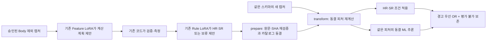

# 피처·HR/SR 명세 모델 → 공통 피처 → ML 통합

최종 명세 패키지와 ML 연구 코드를 연결하는 **오프라인 연구 파이프라인**이다. 기존 LoRA·모델 파일·계산 계약·과거 결과를 수정하지 않는다. `server/`의 런타임 의존성이 아니다.

**2026-11-06 사용자 선택 구성:** 이전 검증 Feature/Rule 설정과 규칙110개, T/P/M42개 피처, 기존 IF·K-means, 추가 학습 LOF를 연결한다.
**새 CSV의 학습·탐지는 [Trainer·Detector 실행 패키지 (#140)](shared42/README.md)를 따른다.** 피처65개·규칙110개·실제 ML 모델9개를 포함하며 원천 재계산과 학습/저장/동결 탐지를 지원한다.
[`restore-previous42` 안내](PREVIOUS_SHARED42.md)는 원래 아카이브 캐시를 대조하는 보존용 재생 경로다. 저장 모델만 사용하는 실행과 LOF 학습 실행을 명시적으로 구분한다.
아래 Process 모델 연결은 보존된 별도 프로필이며 선택 구성으로 자동 전환하지 않는다.

**2026-11-06 최신 ML 연결:** Issue #95 / PR #98의 Process 실행 행 모델을 `research/process_event_model/`에 원형 그대로 포함했다.
최신 IF·K-means·LOF를 쓸 때는 **[`predict-process` 연결 안내](PROCESS_EVENT_INTEGRATION.md)**를 따른다.
같은 원천 Process 행에서 우리 HR/SR과 최신 ML을 결합하며, ML 전용 Python 3.12 프로세스에서 동결 모델을 실행한다.
LLM의 임의 피처를 기존 ML의 학습 입력으로 바꾸거나 재학습하지 않는다.

아래 도표와 `fit`·`predict` 예시는 이전 **공통 피처 벡터 연구 프로필**이며, 최신 Process 모델 실행과 구분한다.



## 무엇을 재사용하는가

| 부분 | 재사용 / 새 연결 |
|---|---|
| 최신 Process 행 ML | `process_event_model`의 동결 IF·K-means·LOF, `predict-process` 전용 경로 |
| 피처·Rule LLM | `research/models/feature_rule_spec`의 Feature silver51·고정 Rule LoRA 및 공식 CLI 그대로 |
| 계산·의미 검증 | 위 패키지의 `Dataset`, `compile_feature`, `replay`, `replay_batch`, `value_condition` 그대로 |
| 기존 공통 피처 ML 알고리즘 | `anomaly_detection/code/model_research_v5/models.py`의 `Encoder`, `RawModel` 재사용: IF·MiniBatch K-means·novelty LOF |
| 점수 | 기존 `process_anomaly_pipeline/features.py`의 `ScoreNormalizer` 재사용 |
| 새 코드 | LLM 산출물 → 행별 공통 피처, 동결 정의 재계산, 명시적 ML fit/load, HR·SR·ML 결과 결합 |

**기존 v12 가중치를 새 피처에 그대로 넣은 결과가 아니다.** v12 IF/K-means는 연속 1분 grid·완료 Process와 고정 시간창 피처를 요구한다. 새 row-feature ML은 기존 알고리즘을 재사용해 별도로 학습하는 모델이다. v12 원본과 기존 시간창 추론 API는 보존하며 [기존 입력 계약](../../anomaly_detection/INTEGRATION.md)을 따른다.

2026-11-02 확인한 프로젝트 `.venv`와 v12 저장 환경의 sklearn 등 버전도 다르다. `inspect-ml`은 두 파일의 SHA와 버전을 확인하며 pickle을 로드하지 않는다. 호환되지 않는 모델을 자동 재학습·설치로 대체하지 않는다.

## 실행 환경

현재 Docker 안의 프로젝트 Python을 사용한다. 설치·다운로드는 이 명령에 포함되지 않는다.

```bash
cd '/home/msko20702/#종합설계/data/.publication/issue89-feature-ml-pipeline'
PY='/home/msko20702/#종합설계/data/.venv/bin/python'
"$PY" -B -m research.integration.feature_rule_ml --help
"$PY" -B -m research.integration.feature_rule_ml inspect-ml
```

다른 checkout에서는 `cd`만 그 저장소 루트로 변경한다. `.venv`를 복사하거나 Conda base를 변경하지 않는다.

## 1. 실제 LLM으로 명세 만들기

기존 공식 CLI를 사용한다. 이 단계만 GPU·Base 모델과 승인된 입력이 필요하다. 공유 GPU 상태와 할당을 확인한 뒤 별도로 실행한다. 이번 연결 검증에서는 새로 실행하지 않았다.

```bash
"$PY" -B research/models/feature_rule_spec/design_cli.py batch \
  --suite /your/approved/suite.json --base-path /your/pinned/qwen-base \
  --output /your/new-specification-run --max-model-calls 32
```

`suite`는 캡처 manifest·요청·Rule 계획·필요한 TRAIN 참조를 지정한다. 임의의 원본 CSV를 자동 승인하는 importer는 아니다. 기존 명세 생성기의 Body·보류 계보·근거 검사와 최대 수정 횟수를 유지한다.

## 2. 생성 결과를 공통 피처로 연결하기

```bash
"$PY" -B -m research.integration.feature_rule_ml prepare \
  --spec-run /your/new-specification-run --suite /your/approved/suite.json \
  --output /your/new-catalog
```

- 저장한 실제 모델 응답과 파일 SHA를 재검증하고, 원천에서 피처를 다시 계산한다. 수작업 CPU 정답을 모델 생성물로 편입하지 않는다.
- `prepared.json`에 계산 계획·의미 SHA·자료형·단위·행 키·원천/측정 버전·검증된 규칙·보류를 연결한다.
- 원천·스키마·행 단위·업무 근거가 다른 묶음은 분리한다. 테이블 이름만 같다는 이유로 합치지 않는다.
- 동일한 계산은 semantic SHA로 중복을 줄인다. 행 값은 `value`·`unavailable`·`not_selected`를 구분한다.

## 3. 새 로그를 같은 피처로 변환하기

```bash
"$PY" -B -m research.integration.feature_rule_ml transform \
  --catalog /your/new-catalog --input-manifest /your/new-capture.json \
  --output /your/new-application-features
```

LLM을 호출하지 않는다. 같은 스키마에서 동결 계산식을 실행하고 의미·타입·단위·모집단 SHA를 대조한다. HR 근거가 사라진 묶음은 별도 보류한다. 스키마 변경은 재설계가 필요하며 조용히 열 이름을 추정하지 않는다. 수치 SR의 기존 조건·참조는 그대로 보존한다. 기준선 유효기간·갱신의 운영 정책은 별도 승인 대상이다.

## 4. 새 피처용 ML 학습 — 명시적 단계

기존 v12 모델과 새 피처의 입력이 다르므로, 새 피처를 쓸 ML은 별도 fit이 필요하다. 세 참조 pack은 같은 동결 카탈로그에서 변환한 것으로, `split`을 각각 `train`, `calibration`, `threshold`로 선언한다. 기존 TRAIN 기간 안에서 세 구간을 만들고 validation/test를 끌어오지 않는다.

```bash
"$PY" -B -m research.integration.feature_rule_ml fit \
  --train /your/train-features --calibration /your/calibration-features \
  --threshold /your/threshold-features --group grain_FROM_prepared_json \
  --features feature_alias_a feature_alias_b --algorithm if \
  --output /your/new-if-model
```

`--algorithm kmeans` 또는 `lof`도 가능하다. 피처 선택은 명시적이며 IF 적격성이 자동 승인되는 것은 아니다. 원시 행 ID는 ML 입력에서 제외한다. 학습 시 계산 가능한 완전 행만 사용하고 제외 수를 남긴다. scaler는 train, 점수 정규화는 calibration, p99 임계값은 threshold에 각각 맞춘다. 최소 8행 검사는 기능상 방어 조건이며 충분한 학습 표본이라는 주장이 아니다.

동일 원천·겹치는 행 키·날짜가 있는 참조의 기간 중첩은 거부한다. 새 ID로 복제한 같은 원천의 완전한 독립성까지 증명하지는 않으며, 모델 기록에도 `not_certified`로 남긴다. 참조 선택에 실제 정상 라벨이 있다고 가정하지 않는다.

## 5. 동결된 HR·SR·ML 실행

```bash
"$PY" -B -m research.integration.feature_rule_ml predict \
  --prepared /your/new-application-features --model /your/new-if-model \
  --trust-local-model --output /your/new-detection-result
```

`--model`은 IF·K-means·LOF별로 반복할 수 있다. 같은 grain의 동일 피처 셀을 사용하며, 각 알고리즘 결과와 이를 OR한 ML 결과를 보존한다. 단위·계산·열 순서·Python/패키지 버전·코드/모델 SHA가 다르면 멈춘다. `--trust-local-model`은 직접 관리하는 모델에만 사용한다.

출력은 `decisions.json`, `report.md`, `manifest.json`이다. 원천 행 키, 발동 규칙 ID·조건·근거, 점수·방향·임계값, 평가 불가 사유, 적용 피처·모델 버전을 기록한다. 점수는 클수록 이상이며 확률이 아니다.

OR 정책은 하나라도 경고면 경고, HR·SR·ML 모두 비경고면 비경고, 그 밖에는 평가 불가다. 규칙이 없거나 근거가 보류된 것을 정상으로 바꾸지 않는다. 수치 피처 결측도 ML 점수 0으로 바꾸지 않는다. 명시적 `is_missing` SR은 계산 불가를 진단할 수 있다.

## 재현 가능한 작은 연결 검사

```bash
"$PY" -B -m unittest discover -s research/integration/feature_rule_ml/tests -v
"$PY" -B -m research.integration.feature_rule_ml.demo \
  --output research/integration/feature_rule_ml/runs/your-new-demo
```

데모는 공개 저장 응답 8건 재생, 피처 7개·보류 1개 연결, 인공 train/calibration/threshold 각 64행, 적용 64행을 사용한다. 기존 연구 코드로 IF·K-means·LOF의 작은 신규 CPU 모델 3개를 만든다. **고객 로그 학습, LoRA 학습, 새 LLM 생성, 실제 운영 성능 평가는 아니다.**

## 아래 일반 공통 벡터 프로필의 제한

아래 목록은 이 문서의 `prepare/fit/predict` 일반 프로필에 적용된다. #140의 선택된 고정 T/P/M 스키마는 원천 전체 시험과 거래 roll-up을 별도로 검증한다.

- 실제 고객 로그 전체에 맞춘 새 row-feature ML 학습·탐지 성능 평가
- v12 시간창 가중치에 임의 피처 추가, 현재 `.venv`에서 v12 pickle 강제 로드
- T/P/M 서로 다른 grain 간 자동 집계·거래별 경보 roll-up
- 지연 도착·watermark·스트리밍 상태·실시간 처리량 보장
- 관리자 승인 UI, `server/` API·DB·알림 연결, 운영 배포

실제 명세 생성과 탐지는 분리한다. 운영에서는 승인된 명세를 동결한 후 새 로그를 코드로 피처화하고 탐지하며, 매 거래마다 LLM을 호출할 필요는 없다.
