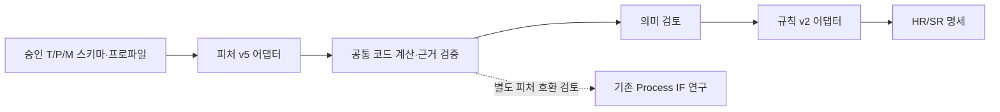

# 기존 research와의 연결 관계

이번 통합은 연구 자료의 배치와 계약 설명이다. 실행 중인 IF 모델이나 `server/`에 자동 연결하지 않는다.

## 자료 위치

| 내용 | 위치 |
| --- | --- |
| 피처·규칙 설계 모델, 두 어댑터, 계약·연구 코드 | `research/models/feature_rule_design_v0_2/` |
| 평가 입력·원문·집계·한계 | `research/evaluation/feature_rule_design_v0_2/` |
| 지정 분석·발굴·보류 과제 구성 | `research/scenarios/feature_rule_design_v0_2/` |
| 기존 IF/K-means·규칙 연구와 학습 모델 | `research/anomaly_detection/` |
| 기존 규칙 생성 v0.1 | `research/models/rule_generator_v0_1/` |

## 기존 IF와 입력이 다른 이유

[Process 파이프라인](../../anomaly_detection/code/process_anomaly_pipeline/README.md)은 Process 실행1행을 분석한다. `duration_ms`, `totalCount`, `retryCount`, `startTime`에서 고정10개 IF 피처를 만들며, Adapter는 모델 라우팅에 사용한다. 저장된 IF 파일에는 그 피처·전처리·판정 기준이 연결돼 있다.

현재 생성 모델은 T/P/M별로 다른 집계 단위·모집단·필터·계산식을 제안한다. 기존71개와 각 원천의 새 정의를 IF의10개 입력에 그대로 추가하거나 바꿀 수 없다. 기존 `duration_ms`와 처리시간 단위·시계가 미확인인 현재 원천도 이름만으로 같은 의미라고 처리하지 않는다.

후속 실행 연결에는 정확한 피처 순서·타입·단위·가용 시점·누출·전처리와 기준선 버전을 먼저 맞춰야 한다. 입력 정의가 달라지면 기존 IF 가중치의 재사용 적격성을 별도로 검토해야 한다. 이 연결 구현과 IF 재학습·추론은 이번 통합 범위에 포함하지 않는다.

현재 규칙 명세는 기존 탐지기의 실행 규칙 객체와도 표현이 다르다. 후속 변환기는 조건·근거·모집단·보류 상태를 보존해야 한다. [서버 계약](../../../server/contracts/) 연결은 별도 결정 사항이다.

## 환경과 보존

생성 모델 연구는 프로젝트 Python3.10 환경, 기존 이상탐지 연구는 별도 Python3.12 기반 기록이다. 각 패키지의 의존성을 구분하고 자동으로 합쳐 설치하지 않는다. 원본 joblib은 로드하지 않았으며 기존 디렉터리 구조·모델 파일·노트북을 변경하지 않았다.
